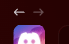
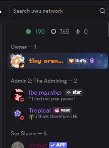

# Mally's shelter plugins

This library targets porting Equicord plugins to shelter. Mostly plugins here are either ported from Equicord/Vencord or forked existing plugins to make it better!

Install any plugin in shelter with `https://Maallly.github.io/shelter-plugins/<plugin>/`, e.g. `https://Maallly.github.io/shelter-plugins/decor/`.

# Plugins

| Plugin | Author | Description |
| --- | --- | --- |
| [Better server tags](#better-server-tags) | Echo & Mally | Make server tags collapsible |
| [Decor](#decor) | Mally | Bring decor to shelter |
| [Expanded Gif selector](#expanded-gif-selector) | Echo & Mally | Expanded gif selector |
| [Global badges](#global-badges) | Mally | Bring other client's badges to shelter |
| [Mention Avatars](#mention-avatars) | Equicord/Vencord, ported by Mally | Add the mentioned user's avatar next to the mention |
| [Message logger](#message-logger) | Mally | Logs messages edit/deletion |
| [Navigator](#navigator) | Equicord/Vencord & Mally | Bring the navigator (built from scratch) to shelter |
| [No pin prompt](#no-pin-prompt) | Equicord/Vencord, ported by Mally | Ignores the pin prompt and auto pins it |
| [Polish Wording](#polish-wording) | Equicord, ported by Mally | Tweaks your messages to make them look nicer and have better grammar |
| [Quest completion](#quest-completion) | Mally | Complete quests |
| [Quick CSS](#quick-css) | Mally | Modify css like quickcss on Vencord! Powered by monaco-editor |
| [Server member count](#server-member-count) | Vencord, ported by Mally | A little widget telling you a bit of the server's member information |
| [Show username](#show-username) | ioj4 & Mally | Show username right next to display name |
| [Text replacer](#text-replacer) | Equicord/Vencord, ported by Mally | Replace texts |
| [TimezoneDB](#timezonedb) | Mally | Timezones for shelter |
| [Trust worthy](#trust-worthy) | SpikeHD & Mally | Trust files, links |

## Better server tags

- Author: Echo & Mally
- Make server tags collapsible
- Install: `https://Maallly.github.io/shelter-plugins/betterServerTags/`

## Decor

- Author: Mally
- Bring decor to shelter. **Only fully works if your client is set to English.**
- Install: `https://Maallly.github.io/shelter-plugins/decor/`

## Expanded Gif selector

- Author: Echo & Mally
- Expanded gif selector
- Install: `https://Maallly.github.io/shelter-plugins/expandedGifSelector/`

## Global badges

- Author: Mally
- Bring other client's badges to shelter
- Install: `https://Maallly.github.io/shelter-plugins/globalBadges/`

## Mention Avatars

- Author: Made by Equicord/Vencord, ported by Mally
- Add the mentioned user's avatar next to the mention
- Install: `https://Maallly.github.io/shelter-plugins/mentionAvatars/`

## Message logger

- Author: Mally
- Logs messages edit/deletion
- Install: `https://Maallly.github.io/shelter-plugins/messageLogger/`

## Navigator

- Author: Equicord/Vencord & Mally
- Bring the navigator (built from scratch) to shelter
- Install: `https://Maallly.github.io/shelter-plugins/navigator/`

## No pin prompt

- Author: Made by Equicord/Vencord, ported by Mally
- Ignores the pin prompt and auto pins it
- Install: `https://Maallly.github.io/shelter-plugins/noPinPrompt/`

## Polish Wording

- Author: Made by Equicord, ported by Mally
- Tweaks your messages to make them look nicer and have better grammar
- Install: `https://Maallly.github.io/shelter-plugins/polishWording/`

## Quest completion

- Author: Mally
- Complete quests
- Install: `https://Maallly.github.io/shelter-plugins/questCompletion/`

## Quick CSS

- Author: Mally
- Modify css like quickcss on Vencord! Powered by monaco-editor
- Install: `https://Maallly.github.io/shelter-plugins/quickCss/`

## Server member count

- Author: Vencord, ported by Mally
- A little widget telling you a bit of the server's member information
- Install: `https://Maallly.github.io/shelter-plugins/serverMembers/`

## Show username

- Author: ioj4 & Mally
- Show username right next to display name in discord
- Install: `https://Maallly.github.io/shelter-plugins/showUsername/`

## Text replacer

- Author: Made by Equicord/Vencord, ported by Mally
- Replace texts
- Install: `https://Maallly.github.io/shelter-plugins/textReplacer/`

## TimezoneDB

- Author: Mally
- Timezones for shelter
- Install: `https://Maallly.github.io/shelter-plugins/timezoneDb/`

## Trust worthy

- Author: SpikeHD & Mally
- Trust files, links
- Install: `https://Maallly.github.io/shelter-plugins/trustWorthy/`
